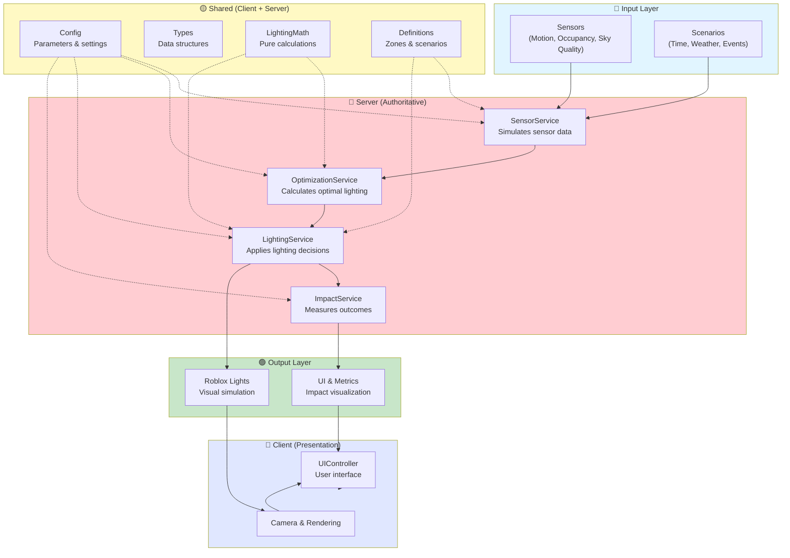

# Mission Dark Sky: Smart Town — System Architecture

## Overview

This diagram shows the high-level service architecture and data flow for the adaptive community lighting simulation.



## Data Flow

| Layer | Responsibility | Key Services |
|-------|---|---|
| **Input** | Sensor readings and scenario conditions | SensorService (simulation) |
| **Processing** | Adaptive optimization and control | OptimizationService, LightingService |
| **Analysis** | Measure impact and outcomes | ImpactService |
| **Shared** | Types, math, config used across all layers | Config, Types, LightingMath, Definitions |
| **Output** | Visual rendering and metrics | Roblox Lights, UI/Metrics |
| **Client** | User interface and camera control | UIController |

## Key Principles

- **Server Authoritative** — All simulation decisions are made on the server
- **Shared Calculations** — Pure math and definitions are in `src/shared` for testability
- **Configuration Driven** — Behavior is controlled via Config, not hardcoded
- **Clear Separation** — Client handles UI/presentation only, never simulation logic

## Directory Structure

```
src/
├── shared/           # Shared code (Config, Types, Math, Definitions)
├── server/           # Server services (simulation & business logic)
└── client/           # Client UI (presentation only)

docs/
└── architecture/     # This documentation
```
